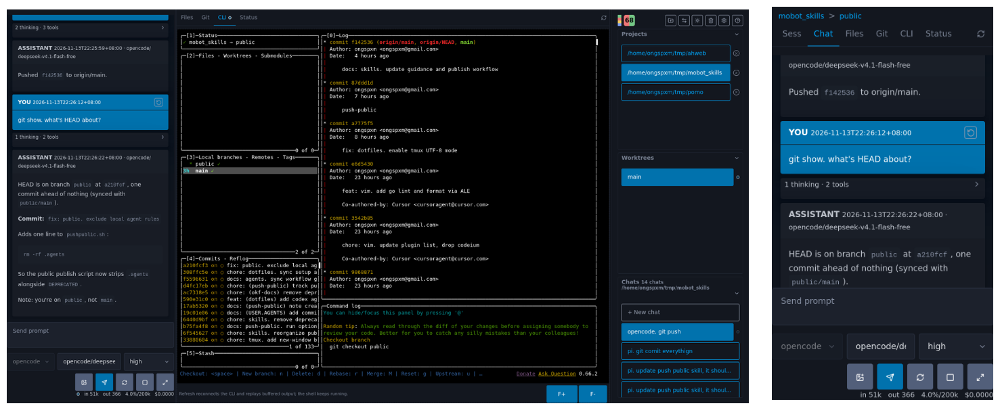

# ahweb
A small local web client for various harnesses.
config is stored in `~/.ahweb/config.json`



```
# install or update local copy of ahweb
go install github.com/ongspxm/ahweb@latest

# run ahweb directly, default port=8321
ahweb
ahweb --port 8000

# install ahweb daemon (linux uses systemd, macos use launchd)
ahweb install
ahweb --port 8000 install

# updating a existing installation
go install github.com/ongspxm/ahweb@latest
ahweb restart

# more info
ahweb help
```

## Development
`go run .` (default port: `8321`); use `go run . -port 9090` to choose a port at startup.

Run `scripts/setup-githooks.sh` for automated checks. See `AGENTS.md` for coding rules and test commands.

## API
All fields required unless marked optional.
- `GET /host` returns normalized instance name, used for identifying server.
- `GET /api/status` returns server stats:
  - `version`: running build version (`(devel)` for development builds).
  - `latest`: latest published version, `(error)` if unavailable.
  - `update`: concise newer-release notice; empty when not outdated.
  - `update_command`: copyable full update command.
  - `update_check_failed`: true if the update comparison could not complete.
- `POST /api/update` starts the fixed update command shown on the Status tab.

### Config & models
- `GET /api/config` returns all config as JSON; `GET /api/config?key=...` returns one value.
- `POST /api/config?key=...&value=...` saves a value to config file.
- `GET /api/models` lists models and reasoning levels per harness.

### Projects & files
- `POST /api/addproject?folder=...` adds a project. Read configured roots from `/api/config`.
- `POST /api/delproject?folder=...` removes project from folder roots.
- `GET /api/worktrees?folder=...` lists worktrees, including the main checkout, as `{ "branch": "...", "dirname": "..." }`. For detached worktrees, `branch` is `"(detached) <first 7 chars of commit>"`; it is empty when unavailable.
- `GET /api/git?folder=...` returns changed files as `{ "files": [{ "status": " M", "path": "..." }] }`, using Git's two-character porcelain status.
- `GET /api/git?folder=...&file=...` returns `{ "diff": "..." }` combining staged and unstaged changes
    - untracked files are shown as additions
    - file=. returns the full patch as raw text
- `GET /api/file?folder=...&path=...` returns immediate children as `{"dirs": [...], "files": [...]}` for directories, or raw bytes with inline content type for files. Missing, outside-folder, or non-regular paths error.
- `POST /api/file?folder=...` accepts multipart `file` and folder-relative `path`; missing destination directories are created. Optional `overwrite=true` replaces an existing regular file; returns `{"path":"..."}`.

### Sessions & chat
- `GET /api/list?folder=...` lists sessions for a folder; child sessions include `parent_sessid`.
- `GET /api/events?folder=...&sessid=...&harness=...&start_from=0&opened=0` returns `sessid`, `name`, `events`, `busy`, `queued`, `queued_images`, `stats`, `tstamp`, and `last_opened`.
    - Set `opened=1` for the active chat to update `last_opened`.
    - Events have `seq` values starting at zero. Use `start_from=0` when opening a session; `start_from=-1` forces a full-history refresh from the web UI.
    - Events may include `images` as data URIs (see `/api/prompt`).
- `POST /api/prompt` takes JSON (`Content-Type: application/json`): `folder`, `prompt`, `harness`; optional: `images`, `sessid`, `model`, `reasoning`.
    - Example: `{"folder":"/path/to/project","prompt":"Hello","harness":"pi"}`. Set `sessid=null` to create a session.
    - Images use data URIs such as `data:image/png;base64,...`. Limits: `max_image_MB` (default 10 MiB decoded per image), `max_prompt_images` (default 4).
    - Returns `sessid`, `harness`, `queued`, `queued_images`, and `busy`.
- `POST /api/stop?folder=...&sessid=...&harness=...` stops a session. Returns `sessid`, `busy`, `queued`, and `queued_images`; waiting and in-flight content is cleared and returned for restoring in the prompt box.
- `POST /api/unqueue?folder=...&sessid=...&harness=...` clears and returns waiting `queued` text and `queued_images` without stopping the active operation.
- `POST /api/rewind?folder=...&sessid=...&harness=...&rewind_id=...` rewinds an idle session. Returns `prompt`, `prompt_images`, and the refreshed full event history
- `POST /cleanup?confirm=0&days=8` previews deletion of sessions older than 8 days across all worktrees. Returns `{"planid":"...","data":{"folder":N}}`. `days` is a required nonnegative integer.
- `POST /cleanup?folder=...&sessid=...` deletes that one session. Returns `{"deleted":true}`; fails if the session is missing or cannot be deleted.
- `POST /cleanup?confirm=1&plan=...` deletes the previewed candidates. Returns `{"data":{"folder":N}}` (plus `error` on partial failures, HTTP 207).
- `GET /api/cli?folder=...&offset=...` is a WebSocket terminal stream. The optional byte `offset` resumes output; the server first sends a text `{"type":"offset","offset":N}` frame, then binary terminal output.

## Adapter interface
Adapters implement `harness.Adapter` (defined in `harness/types.go`) for consistent architecture across harnesses.

Adapter admin fns:
- `Ready() error` nil means ready. Failed adapters are dropped at startup.
- `GetModels() (map[string]Model, error)` returns models keyed by source model ID; include provider only when source identifies it
- `ListSessions(realFolder) ([]SessionLite, error)` lists saved sessions for a folder.
    - try best to get lastLimestampMs and name (name could be null)
    - optionally get the raw FirstUserMsg (if cheap to do)
    - if harness supports it, populate the parent sessID as well (empty for root sessions)

Session admin fns:
- `Connect(*Session, doForceReconnect) error` make sures that the connection is up and live after this call.
    - should be cheap to call (close to no-op) if connection is already alive.
    - returns a partial session obj (SessionLite)
- `CleanUp(*Session) error` closes resources owned by one session.
- `CanDelete() bool` reports whether session deletion is supported.
- `Delete(*Session) error` permanently deletes a session. Run this from the poll worker

Session flow fns:
- `SendPrompt(*Session) error` sends `Session.SendingMsg` and its `Session.SendingImages`.
- `CanSteer(haveImg bool) bool` true when `SendPrompt` can steer active run (`haveImg` = queued input has images). Poll worker sends queued input while busy if true; `SendPrompt` checks `Session.BusyCli` -> steer vs normal prompt.
- `Poll(*Session) error` refreshes session events, title/first user message, and usage stats.
    - When `DoFullHistory` is set, it should load full history; otherwise it may load only new events.
- `Rewind(*Session, rewindID)` rewinds to an event ID. Run this from the poll worker.
- `Stop(*Session) error` stops the active session operation.

Session adapter calls are run by the poll worker, except `Stop`, which the stop API calls directly.

## Adapter feature support
`1` = supported, `0` = not supported, `?` = partial or best effort.
Event model/reasoning rows apply to assistant and thinking events; missing source metadata stays empty.

| Feature | pi | prime | opencode | codex | cursor | claude | copilot |
| --- | --- | --- | --- | --- | --- | --- | --- |
| Reports usage - tokens | 1 | 1 | ? | 1 | 1 | 1 | 1 |
| Reports usage - cost | 1 | 1 | 1 | 1 | 1 | 1 | 1 |
| Reports usage - context wind size | 1 | 1 | 1 | 1 | 0 | ? | 0 |
| Returns thinking events | 1 | 1 | 1 | 1 | 0 | 1 | 1 |
| Returns images on historical reads | 1 | 1 | 1 | ? | 0 | ? | ? |
| Returns tool details on historical reads | 1 | 1 | 1 | 1 | ? | 1 | 1 |
| Return event model | 1 | 1 | 1 | 1 | 1 | 1 | 1 |
| Return event reasoning | 1 | 1 | 1 | 1 | 0 | 1 | 1 |
| Can set prompt reasoning | 1 | 1 | 1 | 1 | 0 | 1 | 1 |
| Can send prompt mid-run | 1 | 1 | 1 | 1 | 0 | 0 | 0 |
| Can send images in prompts | 1 | 1 | 1 | 1 | 1 | 1 | 1 |
| Can open parent-child session | 1 | 1 | 1 | 1 | 1 | 1 | 0 |
| Can Delete session | 1 | ? | 1 | 1 | 0 | 0 | 1 |
| Can Rewind to previous user msg | 1 | 0 | 1 | 1 | 0 | 0 | 0 |
| Impl historical reads thru file/db | 0 | 0 | 0 | 0 | 1 | 1 | 1 |
| Impl Session ctrl thru shared conn | 0 | 1 | 1 | 1 | 0 | 0 | 0 |
| Impl Session ctrl thru isolated RPC | 1 | 0 | 0 | 0 | 0 | 0 | 0 |
| Impl Session ctrl thru short-lived cmd stdout | 0 | 0 | 0 | 0 | 1 | 1 | 1 |

### pi notes
- each sess start one pi cli rpc
- listSessions() pull info from jsonl files
- rewind loads a small embedded RPC extension that navigates to the selected user entry.

### prime notes
- listSession do pure file reading, just like in pi
- when daemon is down on Connect(), we will have logic to start it up (dial loop)
- CleanUp() might actually kill the session (if we are the only one using it -- aka stop the prime ipynb)
- Connect() calls get_state to check if connection is alive
- entire Adapter has one connEvt0 (for updates) and one connCmd0 (for rpc calls)
- new user msg will trigger full tree lookup (for rewindID)

### opencode notes
- must let opencode populate the ID for free-tier models.
- therefore each session will have a sessionID and a OpencodeID
- we start a SSE sess in background to populate the "busyCli" and "events" for each session (which gets processed in Poll)
- token count from SSE is best effort, and may overcount (will fix when big problem later)
- rewind is a 2 stage process, first we stage the revert, then commit it

### claude notes
- claude is cli based: means we use `claude -p` to send prompt, then read stdin for replies, it's not one long lived process
- each process call ends up running a gofunc that listens and process into a cache, then Poll() copies cache content into Session.Events
- child transcripts are read as read-only sessions from `~/.claude/projects/<project>/<parent-id>/subagents/agent-<agent-id>.jsonl`
- claude doesnt support headless rewind, skipping for now

### codex notes
- one single rpc conn for cmds
- one single conn for lsitening to events
- poll will drain the events during Poll()
- context compaction evts appear as assistant msgs: “Context compacted.”
- each codex chat can only have one write connection (so we will set it as readonly when possible)
- multi-agent v2 child sessions are read-only; Codex app-server disallows direct prompts to them

### cursor notes
- cursor-agent doesn't provide context usage
- child transcripts are read as read-only sessions from `~/.cursor/projects/<project>/agent-transcripts/<parent-id>/subagents/<agent-id>.jsonl`
- future: maybe to swap to agents sdk, but not very stable (nor native ui to view)
- chats are resumed through the CLI, and saved history is read from Cursor's local `~/.cursor/projects` transcripts.
- reading tool call from transcript doesnt return result, or success state
- doesnt support headless rewind

### copilot notes
- few sources of info: event jsonl and sqlite3 db
- sqlite3 db used for these use cases: list_sessions, token/cost usage, model listing
- session is defined as (harnessID, harnessSubID), a parent session will have harnessSubID=""
- child sessions are not controllable (cant SendPrompt, Delete, etc etc)
- live polling using stdout from copilot cmd
- delete is hacky: manual remove from db "sessions" table
- rewind is not supported yet.
