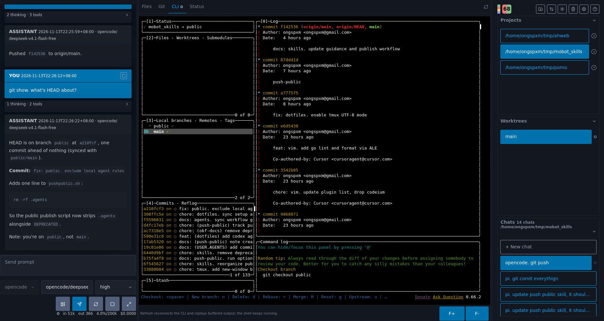
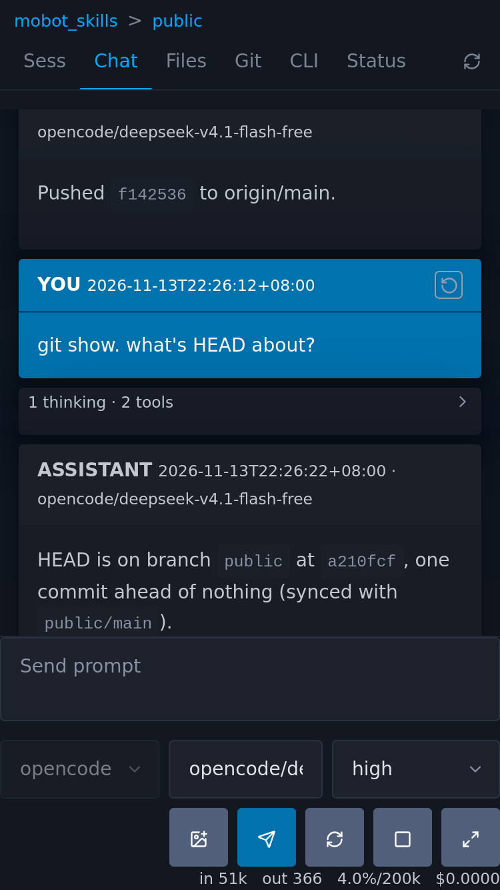

# ahweb
A small local web client for various harnesses.
config is stored in `~/.ahweb/config.json`




```
# install or update local copy of ahweb
go install github.com/ongspxm/ahweb@latest

# run ahweb directly, default port=8321
ahweb
ahweb --port 8000

# install ahweb daemon (linux uses systemd, macos use launchd)
ahweb install
ahweb --port 8000 install

# updating a existing installation
go install github.com/ongspxm/ahweb@latest
ahweb restart

# more info
ahweb help
```

## Development
`go run .` (default port: `8321`); use `go run . -port 9090` to choose a port at startup.

## API
All fields required unless marked optional.
- `GET /host` returns normalized instance name, used for identifying server.
- `GET /api/status` returns a bunch of server stats, including version and update notice, and also running status like harness availability.

### Config & models
- `GET /api/config` returns all config as JSON; `GET /api/config?key=...` returns one value.
- `POST /api/config?key=...&value=...` saves a value to config file.
- `GET /api/models` lists models and reasoning levels per harness.

### Projects & files
- `POST /api/addproject?folder=...` adds a project. Read configured roots from `/api/config`.
- `POST /api/delproject?folder=...` removes project from folder roots.
- `GET /api/worktrees?folder=...` lists worktrees, including the main checkout, as `{ "branch": "...", "dirname": "..." }`. For detached worktrees, `branch` is `"(detached) <first 7 chars of commit>"`; it is empty when unavailable.
- `GET /api/git?folder=...` returns changed files as `{ "files": [{ "status": " M", "path": "..." }] }`, using Git's two-character porcelain status.
- `GET /api/git?folder=...&file=...` returns `{ "diff": "..." }` combining staged and unstaged changes
    - untracked files are shown as additions
    - file=. returns the full patch as raw text
- `GET /api/file?folder=...&path=...` returns immediate children as `{"dirs": [...], "files": [...]}` for directories, or raw bytes with inline content type for files. Missing, outside-folder, or non-regular paths error.

### Sessions & chat
- `GET /api/list?folder=...` lists sessions for a folder.
- `GET /api/events?folder=...&sessid=...&harness=...&start_from=0&opened=0` returns `sessid`, `name`, `events`, `busy`, `queued`, `queued_images`, `stats`, `tstamp`, and `last_opened`.
    - Set `opened=1` for the active chat to update `last_opened`.
    - Events have `seq` values starting at zero. Use `start_from=0` when opening a session; `start_from=-1` forces a full-history refresh from the web UI.
    - Events may include `images` as data URIs (see `/api/prompt`).
- `POST /api/prompt` takes JSON (`Content-Type: application/json`): `folder`, `prompt`, `harness`; optional: `images`, `sessid`, `model`, `reasoning`.
    - Example: `{"folder":"/path/to/project","prompt":"Hello","harness":"pi"}`. Set `sessid=null` to create a session.
    - Images use data URIs such as `data:image/png;base64,...`. Limits: `max_image_MB` (default 10 MiB decoded per image), `max_prompt_images` (default 4).
    - Returns `sessid`, `harness`, `queued`, `queued_images`, and `busy`.
- `POST /api/stop?folder=...&sessid=...&harness=...` stops a session. Returns `sessid`, `busy`, `queued`, and `queued_images`; waiting and in-flight content is cleared and returned for restoring in the prompt box.
- `POST /api/unqueue?folder=...&sessid=...&harness=...` clears and returns waiting `queued` text and `queued_images` without stopping the active operation.
- `POST /api/rewind?folder=...&sessid=...&harness=...&rewind_id=...` rewinds an idle session. Returns `prompt`, `prompt_images`, and the refreshed full event history
- `POST /cleanup?confirm=0&days=8` previews deletion of sessions older than 8 days across all worktrees. Returns `{"planid":"...","data":{"folder":N}}`. `days` is a required nonnegative integer.
- `POST /cleanup?confirm=1&plan=...` deletes the previewed candidates. Returns `{"data":{"folder":N}}` (plus `error` on partial failures, HTTP 207).
- `GET /api/cli?folder=...&offset=...` is a WebSocket terminal stream. The optional byte `offset` resumes output; the server first sends a text `{"type":"offset","offset":N}` frame, then binary terminal output.

## Adapter interface
Adapters implement `harness.Adapter`: to have consistency in code architecture across adapters.

these are generic adapter fns and should be implemented under "=== adapter admin fns" header
- `Ready() error` nil means ready. Failed adapters are dropped at startup.
- `GetModels() (map[string]Model, error)` returns models keyed by model ID "provider/model" (always get from source)
- `ListSessions(realFolder) ([]SessionLite, error)` lists saved sessions for a folder.
    - try best to get lastLimestampMs and name (name could be null)
    - optionally get the raw FirstUserMsg (if cheap to do)
    - if harness supports it, populate the parent sessID as well (empty for root sessions)

these are session admin fns and should be implemented under "=== session admin fns" header
- `Connect(*Session, doForceReconnect) error` make sures that the connection is up and live after this call.
    - should be cheap to call (close to no-op) if connection is already alive.
    - returns a partial session obj (SessionLite)
- `CleanUp(*Session) error` closes resources owned by one session.
- `CanDelete() bool` reports whether session deletion is supported.
- `Delete(*Session) error` permanently deletes a session. Run this from the poll worker.
    - let's simplify the logic: no need to care about "child sessions", just delete
    - rationale: if child session, its deleted based on time anyways, so should be deleted too
    - on webui it doesnt spoil too, if have parentID, but parent no exist, webui handles well

these are session fns (actually control the flow of the session) and should be impleted in "=== session fns" header
- `SendPrompt(*Session) error` sends `Session.SendingMsg` and its `Session.SendingImages`.
- `Poll(*Session) error` refreshes session events, title/first user message, and usage stats.
    - When `DoFullHistory` is set, it should load full history; otherwise it may load only new events.
- `Rewind(*Session, rewindID)` rewinds to an event ID. Run this from the poll worker.
- `Stop(*Session) error` stops the active session operation.

Session adapter calls are run by the poll worker, except `Stop`, which the stop API calls directly.
The interface is defined in `harness/types.go`.

any other fns should be kepts under the "=== util fns" header
Run checks with `go build ./...` and `go test ./...`.

## Adapter feature support
`Y` = supported, `N` = not supported, `?` = partial or best effort.

| Feature | pi | prime | opencode | codex | cursor | claude |
| --- | --- | --- | --- | --- | --- | --- |
| Token count | Y | Y | ? | Y | Y | Y |
| Cost | Y | Y | Y | Y | Y | Y |
| Context usage | Y | Y | Y | Y | N | ? |
| Reasoning levels | Y | Y | Y | Y | N | Y |
| Send images | Y | Y | Y | Y | Y | Y |
| Parent session IDs | Y | Y | Y | Y | N | N |
| Tool results in saved history | Y | Y | Y | Y | ? | Y |
| Delete | Y | ? | Y | Y | N | N |
| Rewind | Y | N | Y | Y | N | N |

### pi notes
- each sess start one pi cli rpc
- listSessions() pull info from jsonl files
- rewind loads a small embedded RPC extension that navigates to the selected user entry.

### prime notes
- listSession do pure file reading, just like in pi
- when daemon is down on Connect(), we will have logic to start it up (dial loop)
- CleanUp() might actually kill the session (if we are the only one using it -- aka stop the prime ipynb)
- Connect() calls get_state to check if connection is alive
- entire Adapter has one connEvt0 (for updates) and one connCmd0 (for rpc calls)
- new user msg will trigger full tree lookup (for rewindID)

### opencode notes
- must let opencode populate the ID for free-tier models.
- therefore each session will have a sessionID and a OpencodeID
- we start a SSE sess in background to populate the "busyCli" and "events" for each session (which gets processed in Poll)
- token count from SSE is best effort, and may overcount (will fix when big problem later)
- rewind is a 2 stage process, first we stage the revert, then commit it

### claude notes
- claude is cli based: means we use `claude -p` to send prompt, then read stdin for replies, it's not one long lived process
- each process call ends up running a gofunc that listens and process into a cache, then Poll() copies cache content into Session.Events
- claude got no parent sess id and context usage estimated hardcoded list
- claude doesnt support headless rewind, skipping for now

### codex notes
- one background reader handles JSON-RPC replies and notifications for the shared app-server process
- context compaction evts appear as assistant msgs: “Context compacted.”
- codex connection cannot have more than 1 writer (so we have isWriter to record which state it is)
- Connect(force=true) might not actually kill because we might end a connection that has some unsaved state

### cursor notes
- cursor-agent doesn't provide context usage or parent session IDs
- future: maybe to swap to agents sdk, but not very stable (nor native ui to view)
- chats are resumed through the CLI, and saved history is read from Cursor's local `~/.cursor/projects` transcripts.
- reading tool call from transcript doesnt return result, or success state
- doesnt support headless rewind
